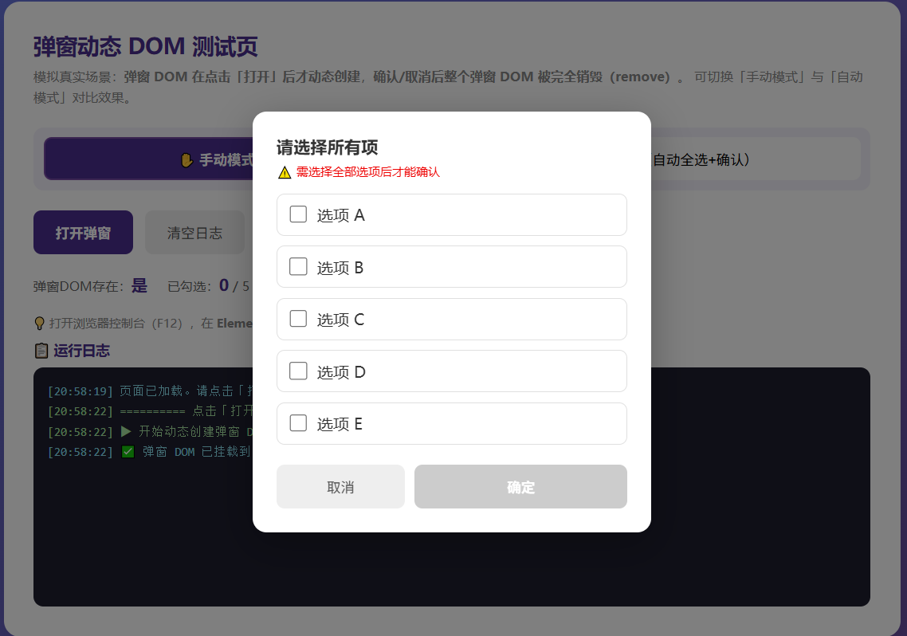
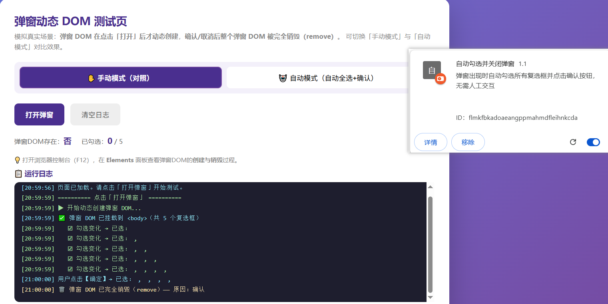
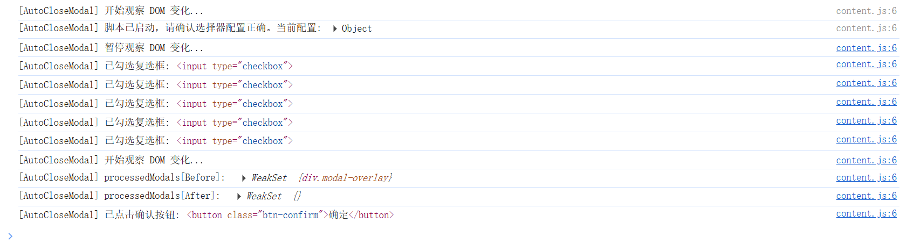

# AutoCloseModal

## Tree

In manifest.json

``` json
{
    "manifest_version": 3,
    "name": "自动勾选并关闭弹窗",
    "version": "1.1",
    "description": "弹窗出现时自动勾选所有复选框并点击确认按钮，无需人工交互",
    "content_scripts": [
        {
            "matches": ["http://*/*", "https://*/*"],
            "js": [
                "./scripts/config.js",
                "./scripts/content.js"
            ]
        }
    ]
}
```


In config.js

~~~ javascript
const Config = (function () {
    return {
        // 弹窗容器选择器：用于判断弹窗是否可见，并限制查找范围
        modalSelector: '.modal-overlay',

        // 复选框选择器：在弹窗容器内查找所有需要勾选的项
        checkboxSelector: 'input[type="checkbox"]',

        // 确认按钮选择器：在弹窗容器内查找按钮
        confirmButtonSelector: '.modal-actions button',
        // 确认按钮文本（用于模糊匹配，大小写不敏感）
        confirmButtonText: ['确定', '确认', 'OK', '同意', '接受', '知道了'],

        // 轮询间隔（毫秒），脚本会定时检查弹窗是否出现
        // interval: 1000,
        // 确认按钮延时点击（毫秒），用于等待弹窗内容加载完成后再点击确认按钮
        confirmButtonDelay: 500,

        // 是否输出调试日志
        debug: true,
    }
})()
~~~


## ScreenShoot

The default page is:




The page after using this plugin is:



